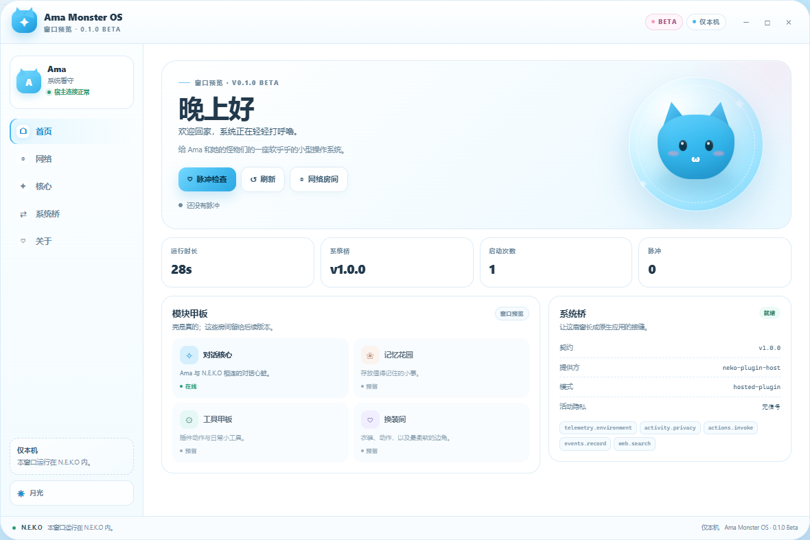
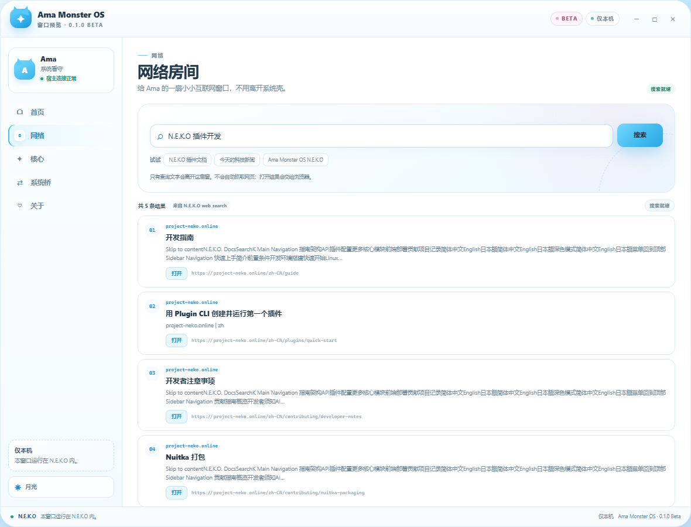
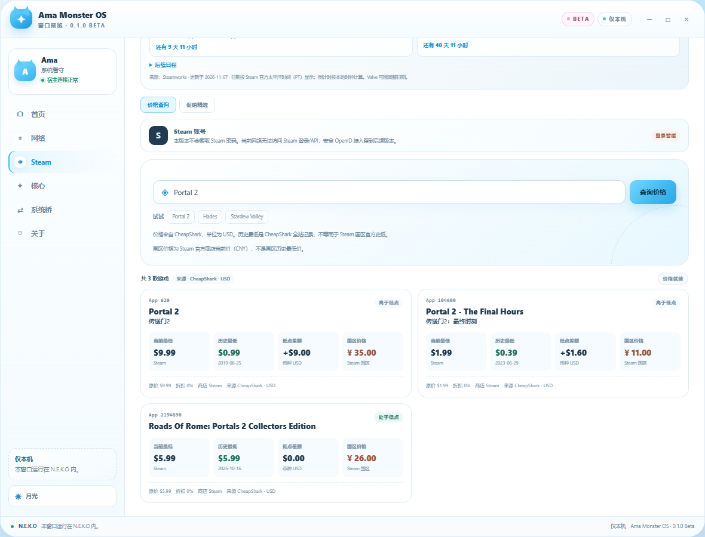
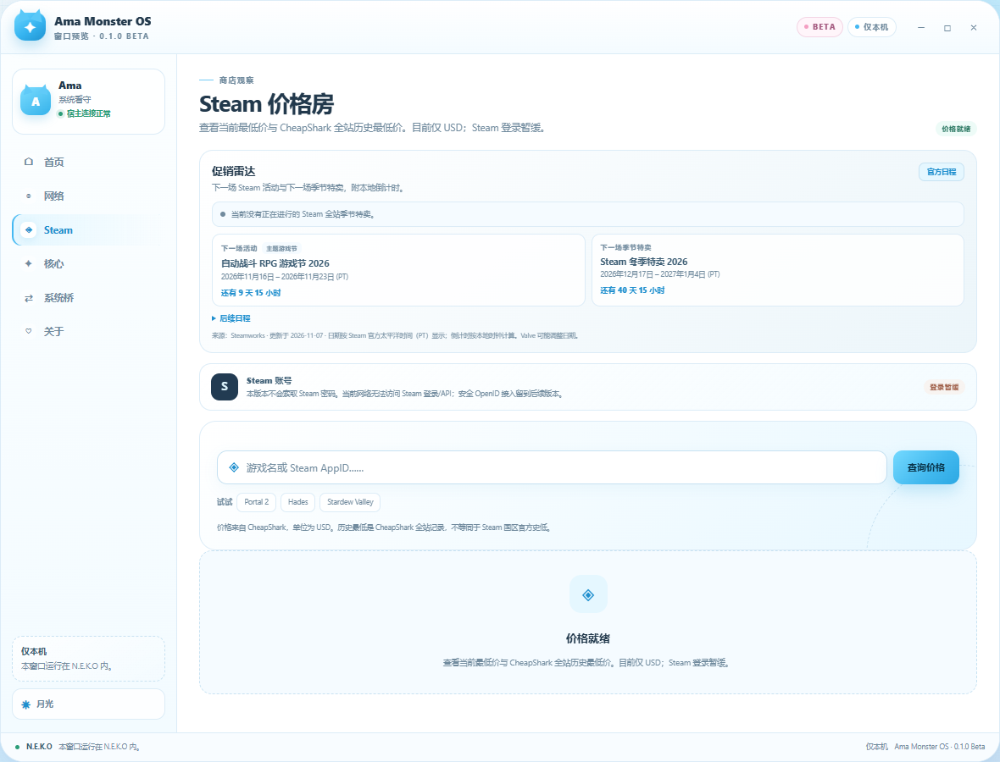
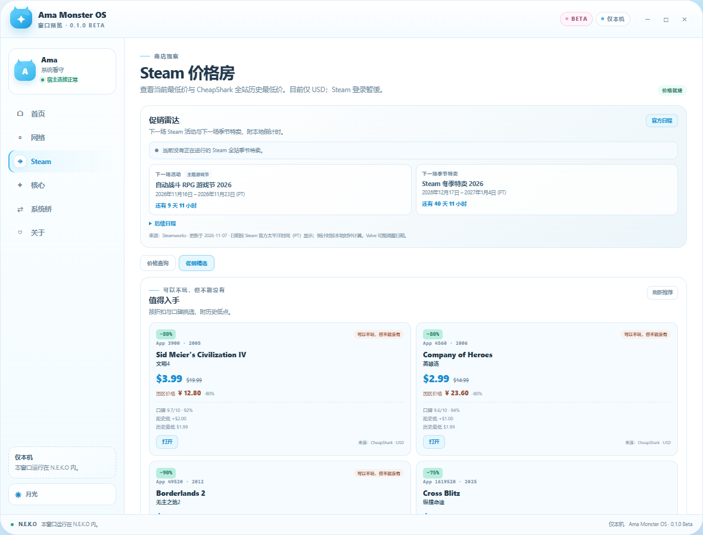
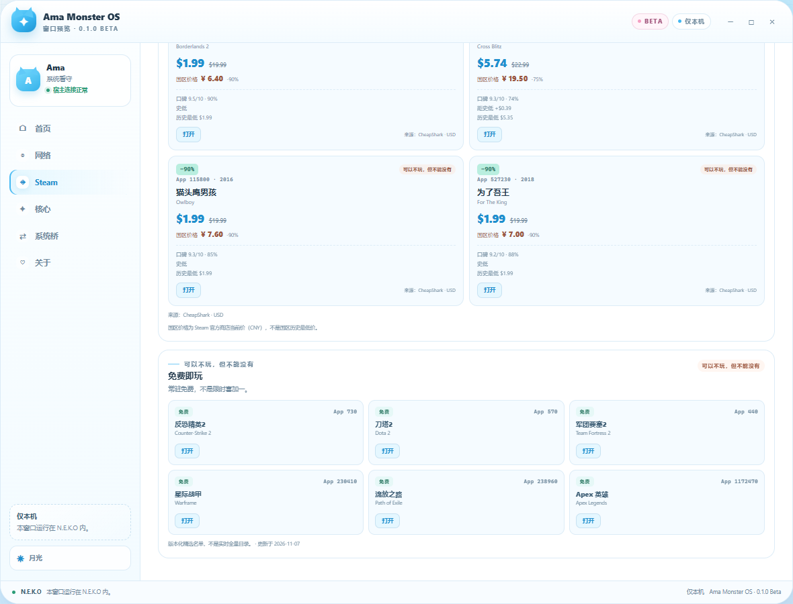
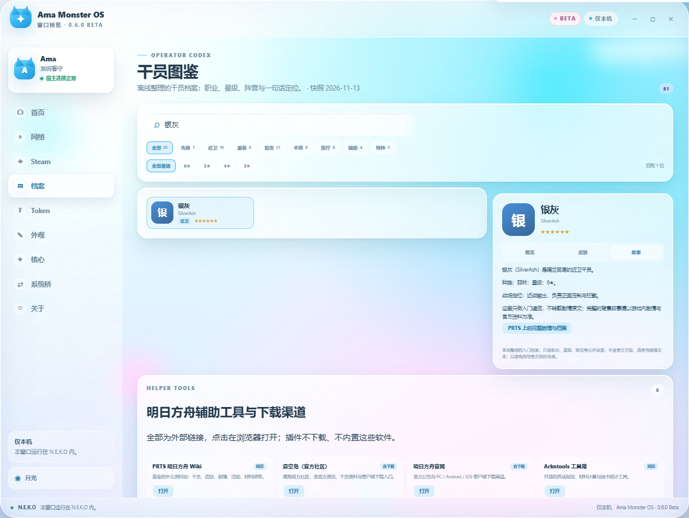
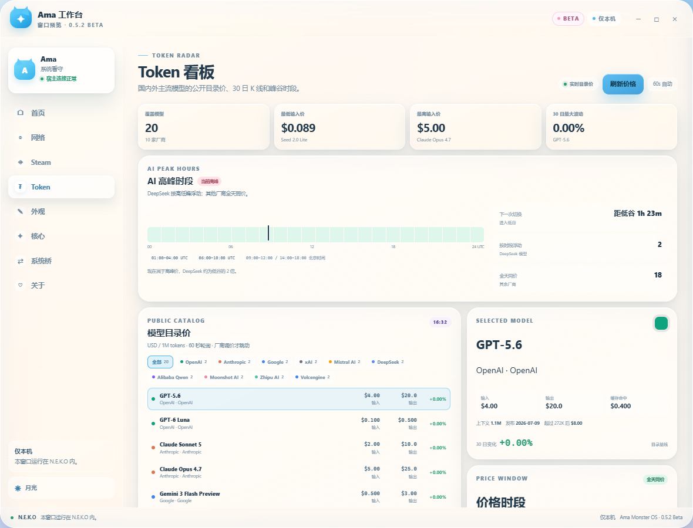

# N.E.K.O Ama Monster OS

> **0.6.1 Beta** · a NEKO-styled shell window for Project N.E.K.O, with live
> web search, a Steam price radar, a token price radar, and a versioned system
> bridge reserved for a future standalone build.



This is the first window of **Ama Monster OS**, not a finished operating
system. It runs as a normal N.E.K.O Hosted TSX plugin and is honest about what
0.6.1 Beta contains.

## What is real in this version

- A working Hosted TSX window: cat-ear title bar, Home/Web/Steam/Studio/Core/Bridge/About
  views, minimize, expand, sleep/wake, day/moon theme, and responsive layout.
- A live snapshot from the plugin: uptime, boot count, bridge health, host
  platform, Python/SDK versions, and privacy-filtered activity.
- A **Web room** with live internet search, result cards, and links that open in
  the user's browser.
- A **Steam price room** with current lowest price, all-time low, low date,
  store, discount, and gap-to-low data from CheapShark (USD), plus the current
  **Steam China price in CNY** from Valve's store API.
- A **Steam sale picks** view with high-discount, well-rated games, historical
  lows, CN prices, and a playful **“可以不玩，但不能没有”** flag.
- A **free-to-play shelf** of 18 permanently free Steam titles in rotating
  groups, versioned as a curated snapshot rather than a live catalogue.
- **Rotating sale picks**: 10 cached batches of high-discount, well-rated games.
- A **Token radar** for public model list prices from OpenAI, Anthropic, Google,
  xAI, Mistral, DeepSeek, Qwen, Kimi, GLM, and Volcengine: 20 models, 30-day
  candlesticks, 60-second refresh, and explicit peak/off-peak windows.
- An **offline Arknights codex** in a wiki-like layout: 81 operators with
  overview, a few sample skins, a data-only story brief, plus a curated
  **helper-tools and download** panel. No official art, voice lines or story
  text is bundled.
- **Five materials**: **glass** (Apple / Xiaomi style translucent panels with
  backdrop blur and rim light), **metal** (brushed steel with chamfered
  highlights), **cream** (cartoon cream with thick outlines and sticker
  shadows), **ink** (rice-paper watercolour with soft corners), and **solid**
  for low-end machines. Blur and density stay adjustable for glass.
- A **UI Studio** for custom accent (swatches, picker, hex input, recent colours), light/dark theme, **window background**
  (including an imported local image), desktop backdrop, corner radius, compact
  density, window title, and glyph. It also includes a **2–30 colour gradient
  builder** and **Steam-style selection sounds**, with custom sound import.
  Profiles are saved in the plugin data folder and can be exported/imported as JSON.
- A **Pulse check** action that calls the Python plugin and refreshes the
  context through the real Hosted UI bridge.
- A stable, versioned contract (`ama.system.bridge` v1.0.0) and a `SystemPort`
  seam designed for the future built-in desktop app.
- Eight locales: `en`, `es`, `ja`, `ko`, `pt`, `ru`, `zh-CN`, `zh-TW`.

## Web search and internet access

The Web room uses a two-step provider chain:

1. **N.E.K.O `web_search`** when that built-in plugin is running. This keeps
   the host's regional engine choice, caching, and retry policy.
2. **Bing RSS fallback** using only the Python standard library when the host
   plugin is stopped or unavailable.

Only the query text leaves the plugin. The window never fetches an arbitrary
URL, never follows a result page automatically, and never opens a link without
a click. The fallback targets one fixed Bing RSS endpoint; result URLs are
validated as `http`/`https` before they are rendered. Opening a result uses the
official Hosted UI external-open bridge and leaves N.E.K.O for your browser.



## Steam price radar

The Steam room searches by game title or numeric Steam AppID and enriches each
match with CheapShark price data:

- current lowest price and store
- all-time low and its date
- gap to the all-time low
- retail price and current discount
- **Steam China current price in CNY** (including its own discount)
- **Chinese game titles** for recommendations, preferring Steam's official
  Simplified Chinese name and falling back to curated aliases for older titles
- explicit **USD**, **CNY**, and **CheapShark cross-store** labeling

The CN price is a live current price from the official Steam Store API
(`cc=cn`). It is **not** a CN historical low: Valve does not publish a public
regional price-history API, and this build does not scrape SteamDB. The all-time
low remains CheapShark's cross-store USD record.



### Sale calendar

A sale radar above the search shows the current sale, the **next Steam event**,
the **next seasonal sale**, and local countdowns. The built-in calendar is
sourced from Valve's Steamworks schedule, captured **2026-11-07**:

| Event | Dates |
|-------|-------|
| Steam Auto-Battler RPG Fest 2026 | Nov 16–23, 2026 |
| Steam Winter Sale 2026 | Dec 17, 2026 – Jan 4, 2027 |
| Steam Spring Sale 2027 | Mar 18–25, 2027 |
| Steam Summer Sale 2027 | Jun 24 – Jul 8, 2027 |
| Steam Autumn Sale 2027 | TBD |

At the time of this build, the next event is **Auto-Battler RPG Fest** and the
next seasonal sale is **Winter Sale 2026**. The UI includes an **Official
schedule** link to Steamworks; Valve can change dates. Dates are shown in
Pacific Time (PT); countdowns use the viewer's local clock.



Sources:
[Steamworks Upcoming Events](https://partner.steamgames.com/doc/marketing/upcoming_events) ·
[Steam Winter Sale 2026](https://partner.steamgames.com/doc/marketing/upcoming_events/2026_winter_sale)

### 值得入手 / 免费即玩

The Steam room has two tabs:

- **价格查询** — the original title/AppID price-history search.
- **促销精选** — a live CheapShark picks list plus the curated free shelf.

Sale picks are filtered to at least **40% off** and a **7/10** CheapShark deal
rating. A larger candidate pool (60 deals) is fetched and filtered down to
roughly **50 qualifying titles**, split into **10 batches of six**. Pressing
**换一批** advances to the next batch, so refreshing no longer repeats the same
six games; a previously viewed batch is cached and returns instantly. Every
batch is enriched with historical lows, current **CNY** prices, and **Chinese
titles**. Cards show a **“可以不玩，但不能没有”** badge when they are 80%+ off,
at or below US$5, or at their all-time low. These are editorial picks, not paid
placements.

Chinese titles prefer the official Steam `l=schinese` name. Older games whose
Steam name stays English use a small curated alias map (for example
`Borderlands 2` → `无主之地2`, `Sid Meier's Civilization IV` → `文明4`). The
English original is always the main title, with the Chinese name directly
underneath.

The free shelf now curates **18 permanently free-to-play** titles with fixed
Steam store links, split into **3 groups of six**. **换一批** advances to the
next group, so the shelf is no longer the same fixed six. It is a versioned
snapshot (updated **2026-11-13**), not a limited-time giveaway tracker and not a
live full catalogue.





**Steam sign-in uses Steam OpenID, not a password form.** The window never asks
for a Steam password and never puts Steam's login page inside the iframe:
it opens `steamcommunity.com/openid/login` in your browser, Steam redirects
back to a loopback port owned by the plugin, the assertion is verified with
`check_authentication`, and only the public SteamID plus the public profile are
stored in the plugin data folder.

Because `steamcommunity.com` is frequently unreachable in mainland China, the
card also reports whether **Steam++ (Watt Toolkit / 瓦特工具箱)** acceleration is
present — either through the hosts-file redirect or a live reachability probe.
If the host is unreachable the card says so instead of failing silently.

The all-time low is CheapShark's cross-store record, not an official Steam
regional low. Steam Community and the Steam Store API were unreachable from the
test network, so they are not used.

## Appearance studio

The **Studio** room is a safe, declarative appearance editor:

- presets: Cloud, Sakura, Mint, Night
- accent colour picker and swatches
- light/dark theme
- **window background**: paper, mist, sakura, glass, gradient, a custom colour,
  or a local PNG/JPG/WebP/GIF image up to 1.2 MB
- **gradient builder**: 2–30 colours, per-stop hex editing, reverse and shuffle, adjustable angle
- **selection sound**: Steam-style tick, soft, mechanical, or a custom WAV/MP3/OGG
  sound up to 1 MB; volume and on/off controls
- desktop backdrop: grid, dots, aurora, stars, plain
- import a JSON profile file, a local background image, or a local sound file
- corner radius and compact density
- custom window title and glyph
- live preview before saving
- persistent profile in the plugin data folder (`data/ui_profile.json`)
- export the profile as JSON, copy it, or paste/import an exported profile

It never accepts arbitrary CSS, remote wallpaper URLs, or executable content.
Every field is length-limited, enumerated, and passed through the same Python
validator before it is written to disk.

**Step-by-step tutorial:** [docs/ui-studio.md](docs/ui-studio.md) — covers making
a profile, hand-writing JSON, exporting, importing, backups, and troubleshooting.







## What is deliberately not here yet

- A general browser or arbitrary-URL reader. This is a search room, not an
  embedded Chromium.
- Steam library, achievements, wallet, friends, or inventory data. Sign-in is
  OpenID only and exposes just the public profile.
- A live tracker for every limited-time free-to-keep giveaway. The free shelf is
  a versioned curated snapshot, not a claim of complete coverage.
- A CN historical-low database. The CN price is current only; Steam does not
  expose a public regional price-history API, and SteamDB is not scraped.
- Arbitrary CSS, remote wallpaper URLs, or user-supplied HTML in the UI studio.
- Native windows, process control, filesystem access, voice pipeline.
- Real chat/memory/tool/style modules. They are shown as **Reserved**, not
  faked as working.
- Any Market publication. The **0.6.1 Beta** GitHub Release is live; its Market
  Beta submission remains manual.

## Install and open the window

1. Open **N.E.K.O → Plugin Manager**.
2. Install the package through **Import**, or use **Developer mode → Load
   unpacked plugin** and point it at this repository folder.
3. Start **N.E.K.O Ama Monster OS**. Auto-start is off by design.
4. Open the plugin's **UI** tab and choose the **Ama Monster OS** panel.

The window chrome is part of the hosted surface. Minimize, expand, and sleep
only affect this panel; they never control the N.E.K.O application window.

## How the system bridge is shaped

```text
Hosted TSX panel (ui/panel.tsx)
        │  props.state / props.api.call
AmaMonsterOsPlugin (__init__.py)
        │
AmaOsRuntime (shell_runtime.py)  ← no N.E.K.O imports
        │
SystemPort (system_contract.py)
        ├── environment / activity
        ├── web.search
        ├── steam.prices
        └── events
        │
NekoHostSystemPort (system_port.py)   now
DesktopSystemPort                      future built-in app
```

The runtime and the JSON contract are host-free. A future desktop build only
implements `SystemPort`; the plugin facade and N.E.K.O adapter are not imported.

Read [docs/system-contract.md](docs/system-contract.md) for the exact protocol,
privacy rules, reserved seams, and integration sequence.

## Project layout

```text
ama_monster_os/
├── plugin.toml                 manifest and Hosted UI surfaces
├── __init__.py                 SDK facade, context, entries, lifecycle
├── shell_runtime.py            host-free shell runtime
├── arknights_codex.py          offline operator codex data
├── steam_catalog.py            versioned free-to-play shelf
├── steam_sales.py              versioned Steam sale calendar
├── ui_profile.py               validated UI profile + import/export
├── system_contract.py          contract v1 + SystemPort protocol
├── system_port.py              N.E.K.O adapter (read-only)
├── ui/panel.tsx                the NEKO-style window
├── docs/quickstart.md           user guide
├── docs/system-contract.md      future built-in integration guide
├── docs/system-contract.v1.schema.json
├── docs/preview.png             shell preview
├── docs/preview-web.png         web room preview
├── docs/preview-cn-price.png    Steam China current price preview
├── docs/preview-sale.png        Steam sale radar preview
├── docs/preview-picks.png       sale picks preview
├── docs/preview-free.png        free-to-play shelf preview
├── docs/preview-glass.png       glass material preview
├── docs/preview-codex.png       operator codex preview
├── docs/preview-metal.png       metal material preview
├── docs/preview-cream.png       cream material preview
├── docs/preview-ink.png         ink material preview
├── docs/preview-token-peak.png  AI peak-hours preview
├── docs/preview-glass-dark.png  glass material (dark) preview
├── docs/preview-studio.png      appearance studio preview
├── docs/preview-token.png       token radar preview
├── docs/preview-token-chart.png token 30-day candles preview
├── docs/token-radar.md          token price and time-window guide
├── docs/preview-studio-sound.png gradient and selection sound preview
├── docs/preview-studio-io.png   appearance import/export preview
├── docs/preview-studio-image.png imported window image preview
├── docs/ui-studio.md            appearance & import/export tutorial
├── i18n/                       8 locale files
└── tests/                      contract, runtime, web, manifest, i18n, UI checks
```

## Development

From the N.E.K.O source checkout (replace the path with your clone):

```powershell
uv run neko-plugin check "<path-to-ama_monster_os>"
uv run neko-plugin check -r "<path-to-ama_monster_os>" --target-dir "<path-to-dist>"
```

Hosted TSX validation, from `frontend/plugin-manager`:

```powershell
node scripts/check-hosted-tsx.mjs "C:\path\to\N.E.K.O\plugin\plugins\ama_monster_os_check"
```

The checker requires the plugin to be inside the N.E.K.O repository. Copy it to
a temporary folder under `plugin/plugins/` for validation; do not symlink.

Run the Python tests directly:

```powershell
cd "<path-to-ama_monster_os>"
python -m pytest tests
```

See [PUBLISHING.md](PUBLISHING.md) for the Beta release and Market submission
notes. The latest GitHub Release is `v0.6.1-beta`; Market notification remains manual.

## Versioning and release

- Manifest version: `0.6.1-beta`
- Display version: **0.6.1 Beta**
- Release channel: **Beta (pre-release)**
- Published GitHub Release: **v0.6.1-beta**
- Market: **not submitted**; the Beta channel submission is manual

## Credits

Author: **呆萌貔貅**

Built for [Project N.E.K.O](https://github.com/Project-N-E-K-O/N.E.K.O).
N.E.K.O and its marks belong to their respective owners.
