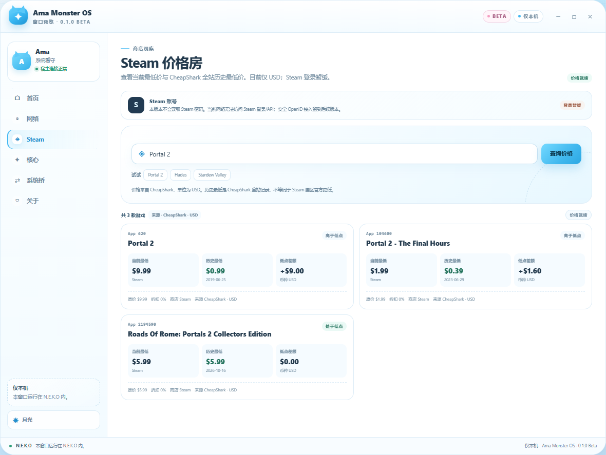

# N.E.K.O Ama Monster OS

> **0.1.0 Beta** · a NEKO-styled shell window for Project N.E.K.O, with live
> web search, a Steam price radar, and a versioned system bridge reserved for a
> future standalone build.


This is the first window of **Ama Monster OS**, not a finished operating
system. It runs as a normal N.E.K.O Hosted TSX plugin and is honest about what
0.1.0 Beta contains.

## What is real in this version

- A working Hosted TSX window: cat-ear title bar, Home/Web/Steam/Core/Bridge/About
  views, minimize, expand, sleep/wake, day/moon theme, and responsive layout.
- A live snapshot from the plugin: uptime, boot count, bridge health, host
  platform, Python/SDK versions, and privacy-filtered activity.
- A **Web room** with live internet search, result cards, and links that open in
  the user's browser.
- A **Steam price room** with current lowest price, all-time low, low date,
  store, discount, and gap-to-low data from CheapShark (USD).
- A **Pulse check** action that calls the Python plugin and refreshes the
  context through the real Hosted UI bridge.
- A stable, versioned contract (`ama.system.bridge` v1.0.0) and a `SystemPort`
  seam designed for the future built-in desktop app.
- Eight locales: `en`, `es`, `ja`, `ko`, `pt`, `ru`, `zh-CN`, `zh-TW`.

## Web search and internet access

The Web room uses a two-step provider chain:

1. **N.E.K.O `web_search`** when that built-in plugin is running. This keeps
   the host's regional engine choice, caching, and retry policy.
2. **Bing RSS fallback** using only the Python standard library when the host
   plugin is stopped or unavailable.

Only the query text leaves the plugin. The window never fetches an arbitrary
URL, never follows a result page automatically, and never opens a link without
a click. The fallback targets one fixed Bing RSS endpoint; result URLs are
validated as `http`/`https` before they are rendered. Opening a result uses the
official Hosted UI external-open bridge and leaves N.E.K.O for your browser.


## Steam price radar

The Steam room searches by game title or numeric Steam AppID and enriches each
match with CheapShark price data:

- current lowest price and store
- all-time low and its date
- gap to the all-time low
- retail price and current discount
- explicit **USD** and **CheapShark cross-store** labeling



**Steam account login is deliberately not enabled in 0.1.0 Beta.** This build
does not ask for a Steam password and does not put Steam's login page inside an
iframe. The account card says **Login deferred** instead of pretending to be
connected. A future safe integration can use Steam OpenID (browser redirect,
no password handled by the plugin) or a user-supplied Web API key.

The all-time low is CheapShark's cross-store record, not an official Steam
regional low. Steam Community and the Steam Store API were unreachable from the
test network, so they are not used.

## What is deliberately not here yet

- A general browser or arbitrary-URL reader. This is a search room, not an
  embedded Chromium.
- Steam account login, Steam library, achievements, or wallet.
- Native windows, process control, filesystem access, voice pipeline.
- Real chat/memory/tool/style modules. They are shown as **Reserved**, not
  faked as working.
- Any Market publication. The repository owner publishes manually.

## Install and open the window

1. Open **N.E.K.O → Plugin Manager**.
2. Install the package through **Import**, or use **Developer mode → Load
   unpacked plugin** and point it at this repository folder.
3. Start **N.E.K.O Ama Monster OS**. Auto-start is off by design.
4. Open the plugin's **UI** tab and choose the **Ama Monster OS** panel.

The window chrome is part of the hosted surface. Minimize, expand, and sleep
only affect this panel; they never control the N.E.K.O application window.

## How the system bridge is shaped

```text
Hosted TSX panel (ui/panel.tsx)
        │  props.state / props.api.call
AmaMonsterOsPlugin (__init__.py)
        │
AmaOsRuntime (shell_runtime.py)  ← no N.E.K.O imports
        │
SystemPort (system_contract.py)
        ├── environment / activity
        ├── web.search
        ├── steam.prices
        └── events
        │
NekoHostSystemPort (system_port.py)   now
DesktopSystemPort                      future built-in app
```

The runtime and the JSON contract are host-free. A future desktop build only
implements `SystemPort`; the plugin facade and N.E.K.O adapter are not imported.

Read [docs/system-contract.md](docs/system-contract.md) for the exact protocol,
privacy rules, reserved seams, and integration sequence.

## Project layout

```text
ama_monster_os/
├── plugin.toml                 manifest and Hosted UI surfaces
├── __init__.py                 SDK facade, context, entries, lifecycle
├── shell_runtime.py            host-free shell runtime
├── system_contract.py          contract v1 + SystemPort protocol
├── system_port.py              N.E.K.O adapter (read-only)
├── ui/panel.tsx                the NEKO-style window
├── docs/quickstart.md           user guide
├── docs/system-contract.md      future built-in integration guide
├── docs/system-contract.v1.schema.json
├── docs/preview.png             shell preview
├── docs/preview-web.png         web room preview
├── docs/preview-steam.png       Steam price room preview
├── i18n/                       8 locale files
└── tests/                      contract, runtime, web, manifest, i18n, UI checks
```

## Development

From the N.E.K.O source checkout (replace the path with your clone):

```powershell
uv run neko-plugin check "<path-to-ama_monster_os>"
uv run neko-plugin check -r "<path-to-ama_monster_os>" --target-dir "<path-to-dist>"
```

Hosted TSX validation, from `frontend/plugin-manager`:

```powershell
node scripts/check-hosted-tsx.mjs "C:\path\to\N.E.K.O\plugin\plugins\ama_monster_os_check"
```

The checker requires the plugin to be inside the N.E.K.O repository. Copy it to
a temporary folder under `plugin/plugins/` for validation; do not symlink.

Run the Python tests directly:

```powershell
cd "<path-to-ama_monster_os>"
python -m pytest tests
```

See [PUBLISHING.md](PUBLISHING.md) for the owner-only Beta release steps. This
repository does not publish itself.

## Versioning and release

- Manifest version: `0.1.0-beta`
- Display version: **0.1.0 Beta**
- Release channel: **Beta**
- The user publishes manually. No tag, GitHub Release, or Market notification is
  created by this repository.

## Credits

Built for [Project N.E.K.O](https://github.com/Project-N-E-K-O/N.E.K.O).
N.E.K.O and its marks belong to their respective owners.
