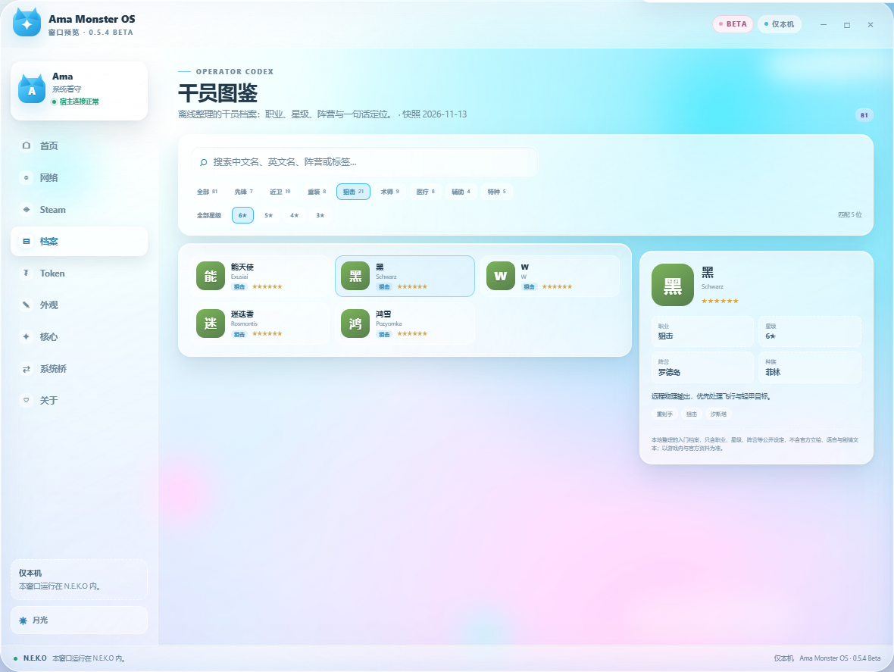

# 明日方舟干员图鉴

**Ama Monster OS 0.6.0 Beta** · Operator Codex

窗口左侧新增 **档案** 页面：一份离线整理的明日方舟干员档案，可以按姓名、职业、星级、阵营检索。

## 一、这是什么

- **本地数据**：干员条目打包在插件里，打开就能用，不需要联网
- **字段**：中文名、英文名、职业、星级、阵营、种族、标签、一句话定位
- **规模**：81 位干员，覆盖 8 个职业、3–6 星
- **快照**：2026-11-13 整理；以游戏内与官方资料为准

> 图鉴**不含官方立绘、语音、剧情文本或 wiki 文案**。卡片头像是按职业配色生成的字母徽章，不是干员立绘。

## 二、怎么用

1. 左侧导航点击 **档案**
2. 在搜索框输入中文名、英文名、阵营或标签，例如：
   - `银灰`
   - `silverash`
   - `企鹅物流`
   - `深海`
3. 点职业标签筛选：先锋 / 近卫 / 重装 / 狙击 / 术师 / 医疗 / 辅助 / 特种
4. 点星级筛选：6★ / 5★ / 4★ / 3★
5. 点任意卡片，右侧显示完整档案

筛选可以叠加：例如「狙击 + 6★」= 5 位。

## 三、字段说明

| 字段 | 含义 |
|---|---|
| 中文名 / 英文名 | 干员名称；英文名用于搜索和对照 |
| 职业 | 先锋、近卫、重装、狙击、术师、医疗、辅助、特种 |
| 星级 | 3–6 星，卡片上以 ★ 显示 |
| 阵营 | 罗德岛、企鹅物流、莱茵生命、喀兰贸易等 |
| 种族 | 菲林、鲁珀、萨科塔、萨卡兹等；不确定的留空显示 `—` |
| 标签 | 例如「速射」「领主」「深海」等检索关键词 |
| 定位 | 按职业生成的一句话说明，不是官方文案 |

## 四、数据边界

- 只包含公开设定字段，不含立绘、语音、剧情、数值面板
- 职业定位文案按职业统一生成，不针对单个干员编写设定
- 数据是**版本化快照**，新干员不会自动出现
- 如果与游戏内不一致，以游戏为准；欢迎在仓库提 issue 修正

## 五、常见问题

| 问题 | 说明 |
|---|---|
| 为什么没有立绘 | 立绘版权属于鹰角网络，插件不内置官方美术资源 |
| 为什么搜不到某位新干员 | 快照截至 2026-11-13，之后实装的干员还没收录 |
| 为什么种族显示 `—` | 部分干员种族在公开资料中未明确，宁缺勿错 |
| 需要联网吗 | 不需要，数据在插件包内 |
| 数据会更新吗 | 随插件版本更新，版本号会写在页头快照日期 |