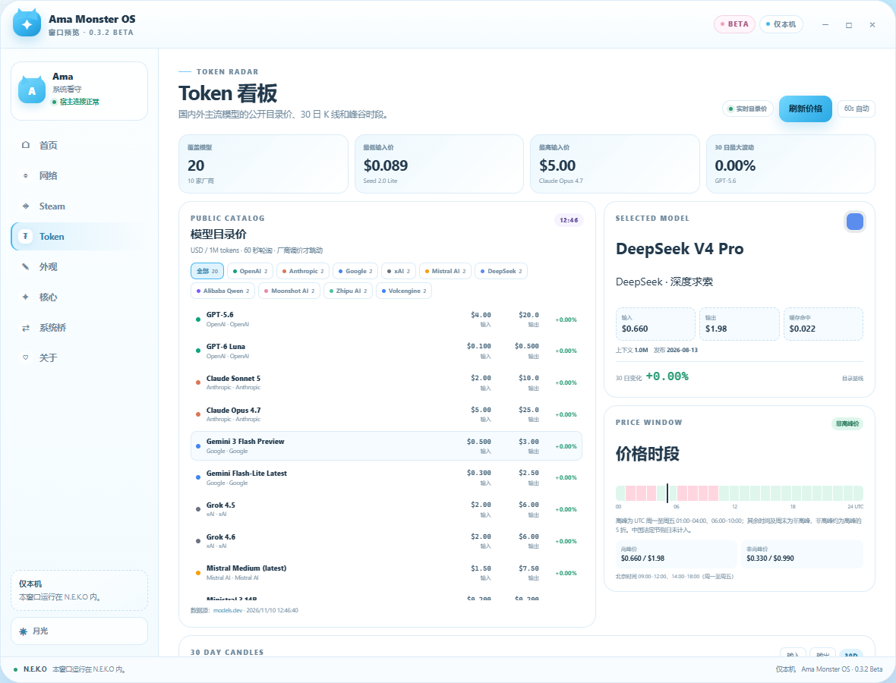
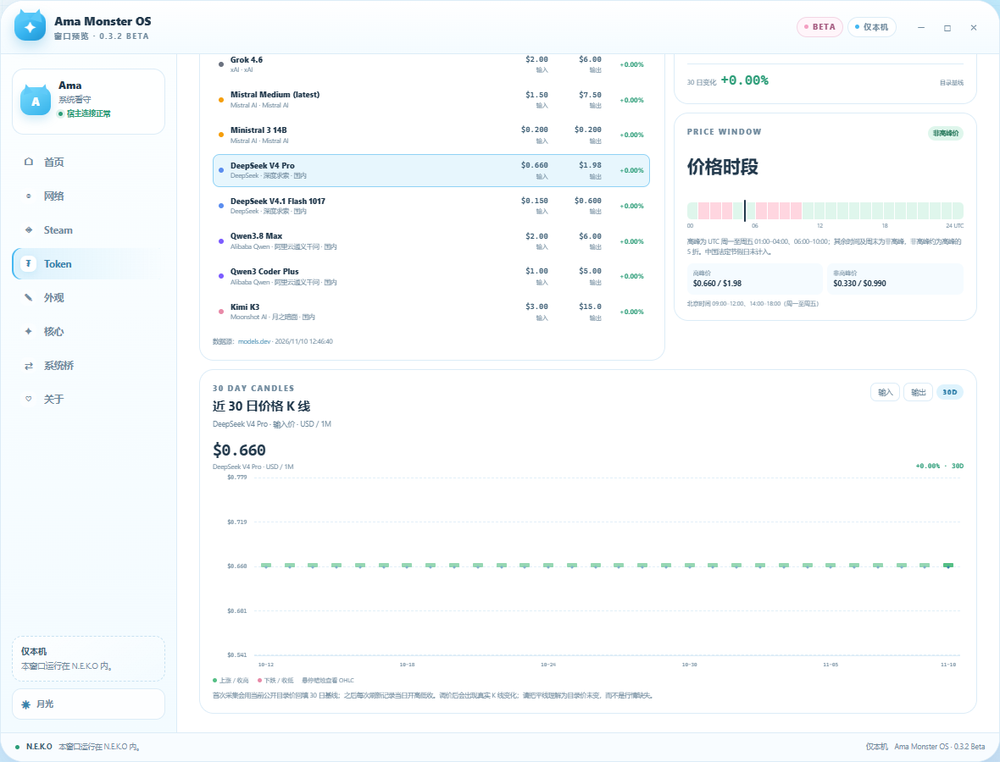

# Token 看板与价格时段说明

**Ama Monster OS 0.3.3 Beta** · Token Radar

Token 看板把国内外主流 AI 厂商的模型目录价、30 日价格 K 线和峰谷时段放进窗口里。它显示的是**公开目录价**，不是股票交易所的逐笔行情：厂商只在调价时改变价格，所以大多数蜡烛会保持平线，这是正常现象。





## 一、数据从哪里来

- 模型目录价：<https://models.dev/>
- 单位：**USD / 1,000,000 tokens**
- 刷新：打开看板后每 **60 秒**轮询一次；手动刷新会绕过 55 秒缓存
- 目录价只在厂商调价时变化，不承诺每秒都有新价格
- 当前覆盖 10 家厂商、20 个代表模型：

| 厂商 | 代表模型 |
|---|---|
| OpenAI | GPT-5.6、GPT-6 Luna |
| Anthropic | Claude Sonnet 5、Claude Opus 4.7 |
| Google | Gemini 3 Flash Preview、Gemini Flash-Lite |
| xAI | Grok 4.5、Grok 4.6 |
| Mistral AI | Mistral Medium、Ministral 3 14B |
| DeepSeek（深度求索） | DeepSeek V4 Pro、DeepSeek V4.1 Flash |
| 阿里云通义千问 | Qwen3.8 Max、Qwen3 Coder Plus |
| 月之暗面 | Kimi K3、Kimi K2.6 |
| 智谱 | GLM-4.6、GLM-4.5 |
| 火山引擎（字节） | Seed 2.1 Pro、Seed 2.0 Lite |

> 展示的是公开目录价，不含你的折扣、代金券、汇率和税费；人民币价格请以厂商账单为准。

## 二、看懂价格

- **输入价**：每 100 万输入 tokens 的目录价
- **输出价**：每 100 万输出 tokens 的目录价
- **缓存命中**：命中上下文缓存时的输入价
- **上下文**：模型最大上下文
- **超过 X 后**：部分模型在上下文超过阈值后进入更高价格档
- **30 日变化**：第一根与最后一根蜡烛的收盘价变化

### 为什么很多 K 线是平的？

因为模型价格不是股票，厂商通常几周甚至几个月才调一次价。第一次打开看板时，会用**当前公开目录价回填 30 日基线**，让你先有一个月的时间轴；之后每次刷新记录当日开高低收。若价格没变，蜡烛自然是平线。调价后会出现真实的开高低收变化。

看板底部的说明也会标明：

- `目录基线`：首次采集回填的历史
- `本机观测`：插件开始记录后采集到的价格

不会用随机数据伪造历史波动。

## 三、什么时间便宜，什么时间贵

### DeepSeek：有明确的峰谷价

DeepSeek 官方定价页说明：

- 高峰时段（UTC 周一至周五）：
  - **01:00–04:00 UTC**
  - **06:00–10:00 UTC**
- 北京时间：
  - **09:00–12:00**
  - **14:00–18:00**
- 其余时间、周末、中国法定节假日：**非高峰**
- 非高峰约为高峰的 **5 折**

看板会把当前时间标成 **高峰价 / 非高峰价 / 周末非高峰**，并显示：

```text
高峰：$0.660 输入 / $1.98 输出
非高峰：$0.330 输入 / $0.990 输出
```

> 中国法定节假日无法仅靠时区判断，看板没有内置节假日日历，所以节假日当天仍可能显示“高峰”。实际扣费以 DeepSeek 官方账单为准。

### 其他厂商：没有早晚峰谷

OpenAI、Anthropic、Google、xAI、Mistral、Qwen、Kimi、GLM、火山引擎的展示模型都是**按 token 统一目录价**，没有“晚上便宜”的时钟规则。真正让价格变便宜的是：

- **缓存命中**：缓存读取价通常远低于输入价
- **Batch 批处理**：异步批处理通常有折扣
- **上下文档位**：短上下文便宜，超长上下文更贵
- **模型档位**：Mini/Flash/Lite 比 Pro/Opus 便宜
- **厂商活动**：限时折扣与代金券不在目录价里

所以“便宜时段”只对 DeepSeek 这类明确公布峰谷价的厂商成立；其余厂商要看缓存和批处理，而不是看钟点。

## 四、操作

1. 左侧导航点击 **Token**
2. 点厂商标签筛选，或点模型行选中
3. 点 **输入 / 输出** 切换 K 线指标
4. 点 **刷新价格** 立即拉取；点 **60s 自动** 开关轮询
5. 把鼠标悬停在蜡烛上查看当天的开 / 高 / 低 / 收

数据源失败时会保留上一次快照并标注 **缓存价**，不会把空数据画成 0 元。

## 五、边界

- 只读取公开目录，不需要任何厂商 API Key
- 不读取你的账单、余额、用量或密钥
- 价格是 USD 目录价，不是人民币实付价
- K 线历史在首次打开时用当前目录价回填；不是伪造的交易所历史
- 厂商调价后，后续刷新会出现真实变化
- 网络失败时显示缓存并标注状态

## 六、常见问题

| 问题 | 说明 |
|---|---|
| K 线为什么是平的 | 该模型近 30 日目录价没有变化，或仍是首次回填的目录基线 |
| 价格和账单不一致 | 目录价不含你的折扣、汇率、税费、缓存/批处理优惠 |
| 为什么没有某家厂商 | 当前精选 10 家代表厂商；可继续扩展目录 |
| 刷新后没变化 | 厂商未调价；看板每 60 秒轮询，不是逐笔行情 |
| DeepSeek 现在为什么是高峰 | 以 UTC 周一至周五 01:00–04:00、06:00–10:00 判断；法定节假日未计入 |
| 数据源打不开 | 保留上次快照，状态会显示“缓存价”或“价格源异常” |
