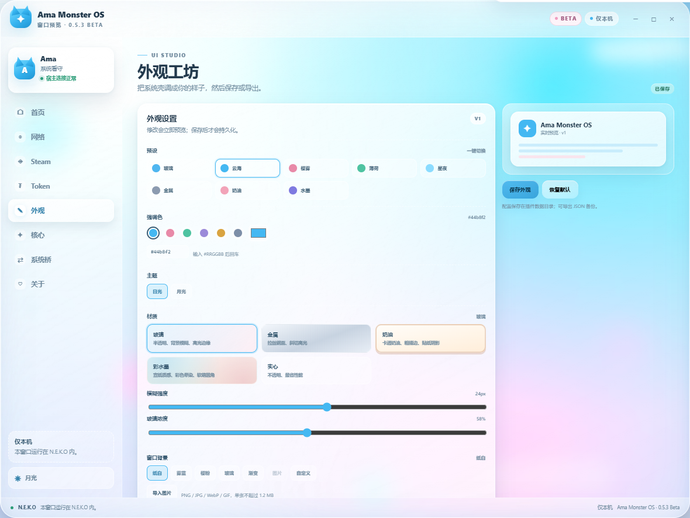
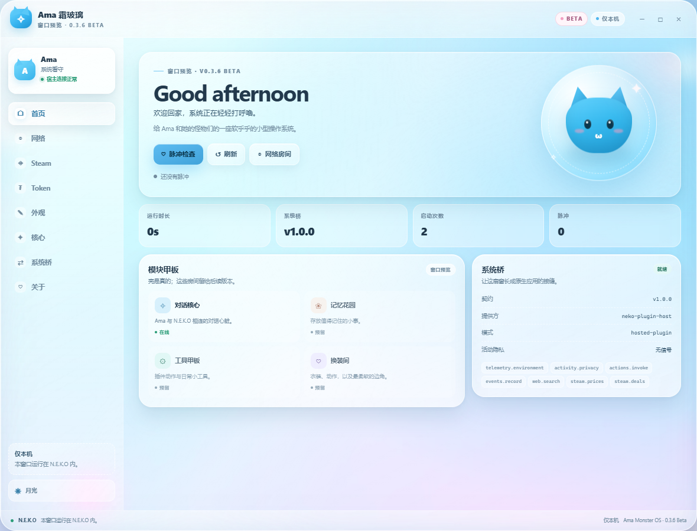
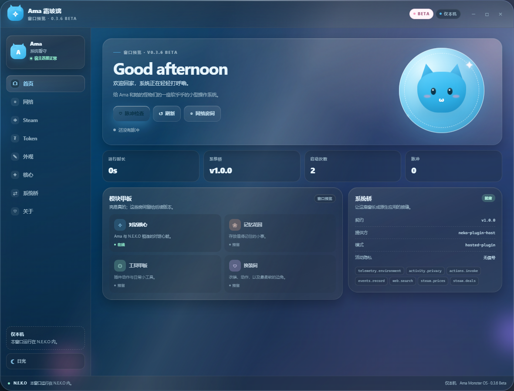
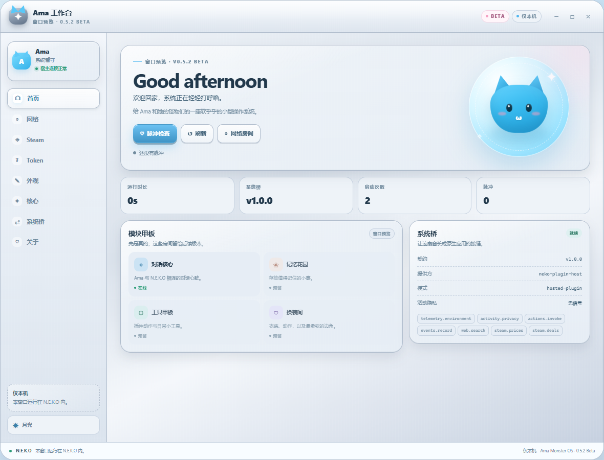
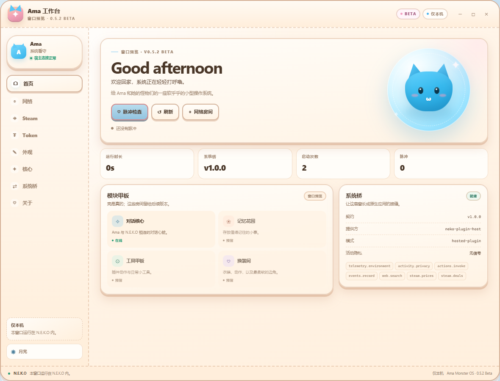
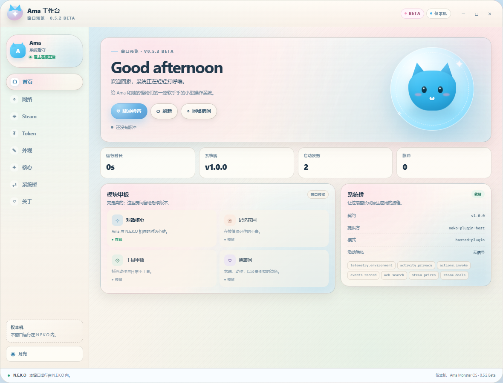
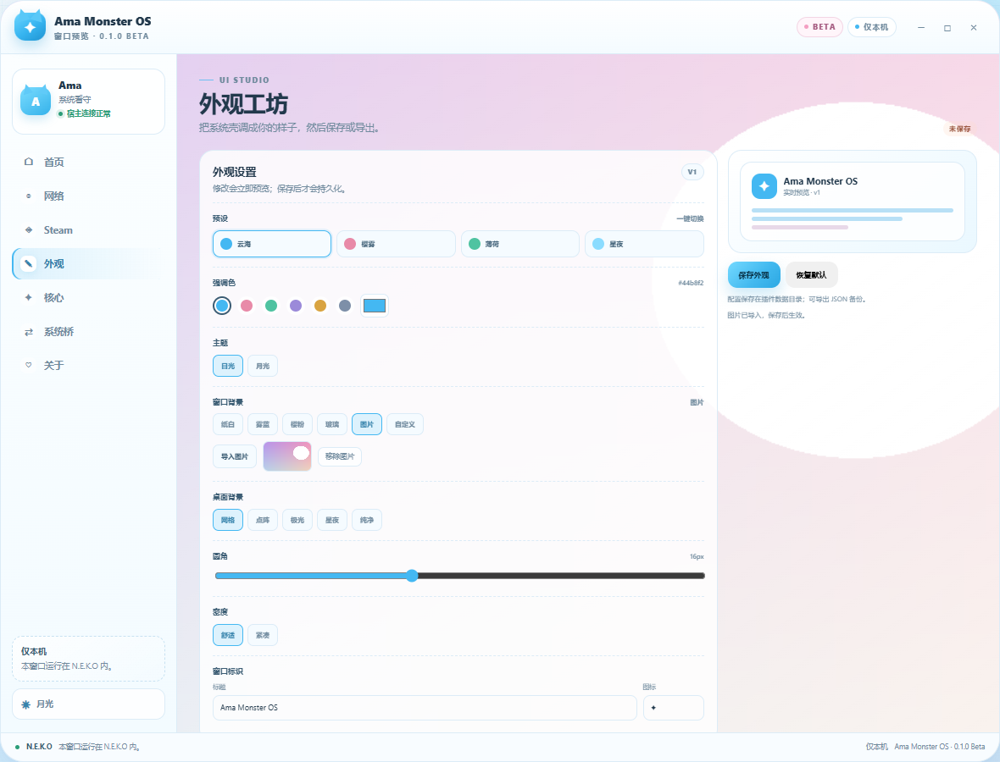
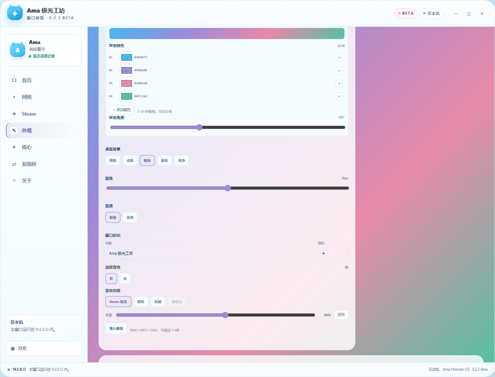
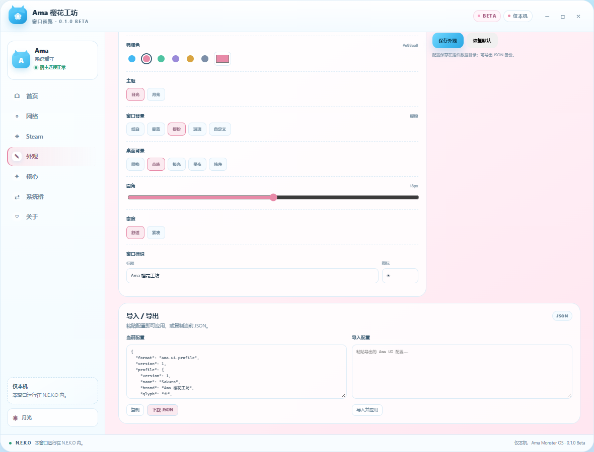

# 自定义外观与导入导出教程

**Ama Monster OS 0.5.2 Beta** · UI Studio · `ama.ui.profile` v1

这篇教程讲三件事：

1. 在窗口里直接制作一套自己的外观。
2. 把外观导出成 JSON，备份或分享。
3. 导入别人制作的 JSON，并恢复或迁移自己的外观。

> UI Studio 只接受受支持的颜色、枚举、长度和数值范围。它不会执行任意
> CSS、HTML、JavaScript，也不会加载远程壁纸或图片。



## 一、先认识外观配置

一套外观是一个 JSON 对象，完整格式如下：

```json
{
  "format": "ama.ui.profile",
  "version": 1,
  "profile": {
    "version": 1,
    "name": "Sakura",
    "brand": "Ama Monster OS",
    "glyph": "✦",
    "accent": "#e88aa8",
    "wallpaper": "dots",
    "window_bg": "sakura",
    "window_color": "#ffffff",
    "window_image": "",
    "gradient_colors": ["#44b8f2", "#9b8ad9", "#e88aa8"],
    "gradient_angle": 135,
    "sound_enabled": true,
    "sound_mode": "steam",
    "sound_volume": 0.55,
    "sound_data": "",
    "sound_name": "",
    "radius": 16,
    "density": "comfortable",
    "theme": "light"
  }
}
```

字段说明：

| 字段 | 类型 | 说明 |
|------|------|------|
| `format` | 字符串 | 固定为 `ama.ui.profile`，用于识别文件 |
| `version` | 数字 | 当前为 `1` |
| `profile.name` | 字符串 | 配置名称，最长 32 字符 |
| `profile.brand` | 字符串 | 窗口左上角标题，最长 24 字符 |
| `profile.glyph` | 字符串 | 窗口图标，最长 2 字符，例如 `✦`、`❀`、`♥` |
| `profile.accent` | 字符串 | 六位十六进制颜色，例如 `#44b8f2` |
| `profile.wallpaper` | 字符串 | 窗口外桌面背景：`grid` / `dots` / `aurora` / `stars` / `plain` |
| `profile.window_bg` | 字符串 | **窗口本身背景**：`paper` / `mist` / `sakura` / `glass` / `gradient` / `image` / `custom` |
| `profile.window_color` | 字符串 | `window_bg=custom` 时的窗口背景色，六位十六进制 |
| `profile.window_image` | 字符串 | `window_bg=image` 时的本地图片 data URL；不要手填远程 URL |
| `profile.gradient_colors` | 数组 | `window_bg=gradient` 时的 2–30 个十六进制颜色 |
| `profile.gradient_angle` | 数字 | 渐变角度，0–360 |
| `profile.sound_enabled` | 布尔 | 是否启用选取音效 |
| `profile.sound_mode` | 字符串 | `steam` / `soft` / `mechanical` / `custom` |
| `profile.sound_volume` | 数字 | 音量，0–1 |
| `profile.sound_data` | 字符串 | 自定义音效的本地 data URL；不要手填远程 URL |
| `profile.sound_name` | 字符串 | 自定义音效显示名，最长 80 字符 |
| `profile.material` | 字符串 | 材质：`glass` / `metal` / `cream` / `ink` / `solid` |
| `profile.glass_blur` | 数字 | 玻璃模糊强度，6–40，默认 24 |
| `profile.glass_alpha` | 数字 | 玻璃浓度，28–92，默认 58 |
| `profile.radius` | 数字 | 圆角，8–28，超出会截断 |
| `profile.density` | 字符串 | `comfortable` / `compact` |
| `profile.theme` | 字符串 | `light` / `dark` |

> `wallpaper` 是窗口**外**的桌面花纹；`window_bg` 才是窗口**本身**的背景。
> 两者可以独立设置。

也可以只写 `profile` 里的字段，不带 `format` 外层：

```json
{
  "brand": "Ama 夜航",
  "glyph": "☾",
  "accent": "#8bdcff",
  "wallpaper": "stars",
  "window_bg": "glass",
  "window_color": "#ffffff",
  "radius": 20,
  "density": "compact",
  "theme": "dark"
}
```

导入时缺少的字段会用默认值补齐；非法颜色、未知枚举、超长文字和越界圆角
会被自动纠正，而不是执行。

## 二、在窗口里制作外观

### 第 1 步：打开外观工坊

打开 **N.E.K.O → 插件管理 → Ama Monster OS → UI**，在左侧导航点击
**外观**。

### 第 2 步：选一个起点

顶部有四个预设：

- **云海**：浅色、蓝色强调色、网格背景
- **樱雾**：浅色、粉色强调色、点阵背景
- **薄荷**：浅色、绿色强调色、极光背景
- **星夜**：深色、浅蓝强调色、星空背景

预设只是一键起点，后面还可以继续改。

### 第 3 步：微调

- **强调色**：点色板，或使用右侧取色器
- **主题**：日光 / 月光
- **窗口背景**：纸白 / 雾蓝 / 樱粉 / 玻璃 / 渐变 / 图片 / 自定义颜色
- **桌面背景**：网格 / 点阵 / 极光 / 星夜 / 纯净
- **圆角**：拖动 8–28px
- **密度**：舒适 / 紧凑
- **窗口标识**：修改标题和图标
- **选取音效**：Steam 轻点 / 柔和 / 机械 / 自定义

修改会立即显示在整个窗口里。右上角会从 **已保存** 变成 **未保存**。

### 第 4 步：保存

点击 **保存外观**。

- 配置写入插件数据目录的 `data/ui_profile.json`
- 重新打开窗口或重启插件后会自动恢复
- 如果只预览没保存，重开窗口会回到上次保存的版本

### 第 5 步：选择材质（苹果 / 小米式玻璃）

外观工坊新增 **材质**，共 5 种：

| 材质 | 风格 |
|---|---|
| **玻璃** | 半透明面板 + 背景模糊 + 高光边缘 + 柔和投影（苹果 / 小米式） |
| **金属** | 拉丝钢面、斜切高光、硬朗边框与立体投影 |
| **奶油** | 卡通奶油底、粗描边、虚线分隔、贴纸式硬阴影 |
| **彩水墨** | 宣纸质感、彩色晕染、软萌圆角，像水墨插画 |
| **实心** | 不透明，最省性能 |

选中玻璃后可以调：

- **模糊强度**：6–40px
- **玻璃浓度**：28–92%

玻璃模式下窗口、标题栏、侧边栏、卡片、输入框和按钮都会统一成同一套材质；暗色主题有单独的玻璃配色，避免发灰。











> 金属 / 奶油 / 彩水墨都是纯 CSS 实现，不加载图片，不注入任意样式。

> 玻璃效果依赖浏览器的 `backdrop-filter`。老浏览器会自动退回接近不透明的背景，保证文字可读。

### 第 5 步：导入外部图片作为窗口背景

1. 在 **窗口背景** 选择 **图片**。
2. 点击 **导入图片**。
3. 选择本地 `PNG` / `JPG` / `WebP` / `GIF`，单张不超过 **1.2 MB**。
4. 预览确认后点击 **保存外观**。

图片会以 data URL 形式保存在配置文件里，不依赖远程图床；移除图片会回到纸白背景。



### 第 6 步：制作颜色渐变

1. 在 **窗口背景** 选择 **渐变**。
2. 用每个颜色行的取色器修改颜色。
3. 点击 **添加颜色**，最多 30 种；点击 `×` 删除，至少保留 2 种。
4. 拖动 **渐变角度**，0–360°。
5. 预览确认后点击 **保存外观**。

颜色会均匀分布；非法颜色和重复颜色会被自动过滤。

### 第 7 步：设置选取音效

1. 在 **选取音效** 选择 **开**。
2. 选择风格：**Steam 轻点** / **柔和** / **机械**。
3. 拖动音量，或点 **试听**。
4. 如需自己的音效，点击 **导入音效**，选择 WAV / MP3 / OGG（不超过 1 MB）。
5. 点击 **保存外观**。

选中音效会在点击导航、按钮、标签页时播放。自定义音效以 data URL 保存在
配置里，不依赖原文件路径。



### 第 8 步：导出

在 **导入 / 导出** 区域：

- **下载 JSON**：下载 `ama-ui-profile.json`
- **复制**：把当前配置复制到剪贴板
- 也可以直接选中文本框里的 JSON 手动复制

如果浏览器/宿主拦截了下载，使用 **复制** 仍然可用。



## 三、导入一套外观

### 方法 A：从别人分享的 JSON 导入

1. 打开 **外观** 页面。
2. 找到 **导入配置**。
3. 粘贴完整的 JSON（带不带 `format` 外层都可以）。
4. 点击 **导入并应用**。
5. 检查预览和标题栏。
6. 点击 **保存外观** 持久化。

如果没有点保存，导入只对当前窗口会话生效。

### 方法 B：恢复自己的备份

1. 打开之前导出的 `ama-ui-profile.json`。
2. 复制全部内容。
3. 粘贴到 **导入配置**。
4. **导入并应用 → 保存外观**。

### 方法 C：手写一套配置

1. 新建一个 UTF-8 文本文件，扩展名改成 `.json`。
2. 按上面的格式写入配置。
3. 用编辑器的 JSON 校验功能确认没有多余逗号。
4. 把全文粘贴到 **导入配置**，点击 **导入并应用**。
5. 点击 **保存外观**。

### 方法 D：直接导入外部配置文件

1. 打开 **外观** 页面。
2. 在 **导入配置** 旁点击 **导入 JSON 文件**。
3. 选择之前导出的 `ama-ui-profile.json` 或手写的配置文件。
4. 预览确认后点击 **保存外观**。


注意：

- 颜色必须是 `#` 加六位十六进制，例如 `#44b8f2`，不能写 `blue`。
- `wallpaper`、`density`、`theme` 只能使用上表中的英文值。
- 中文标题、图标可以直接写；会按 UTF-8 保存。
- 文本字段有长度限制，超长会被截断。

## 四、直接制作 JSON 的示例

### 樱雾

```json
{
  "format": "ama.ui.profile",
  "version": 1,
  "profile": {
    "version": 1,
    "name": "Sakura",
    "brand": "Ama 樱花工坊",
    "glyph": "❀",
    "accent": "#e88aa8",
    "wallpaper": "dots",
    "window_bg": "sakura",
    "window_color": "#ffffff",
    "radius": 18,
    "density": "comfortable",
    "theme": "light"
  }
}
```

### 星夜

```json
{
  "format": "ama.ui.profile",
  "version": 1,
  "profile": {
    "version": 1,
    "name": "Night",
    "brand": "Ama 夜航",
    "glyph": "☾",
    "accent": "#8bdcff",
    "wallpaper": "stars",
    "window_bg": "glass",
    "window_color": "#ffffff",
    "radius": 20,
    "density": "compact",
    "theme": "dark"
  }
}
```

### 薄荷

```json
{
  "format": "ama.ui.profile",
  "version": 1,
  "profile": {
    "version": 1,
    "name": "Mint",
    "brand": "Ama Monster OS",
    "glyph": "✦",
    "accent": "#4fc3a1",
    "wallpaper": "aurora",
    "window_bg": "mist",
    "window_color": "#ffffff",
    "radius": 16,
    "density": "comfortable",
    "theme": "light"
  }
}
```

## 五、常见问题

| 问题 | 处理 |
|------|------|
| 点了保存但重开没变化 | 确认提示为“外观已保存”；查看插件日志和数据目录写权限 |
| 下载按钮没反应 | 使用 **复制**，把 JSON 保存到本地文件 |
| 导入提示无效 | 检查 JSON 是否有语法错误；`format` 必须是 `ama.ui.profile` |
| 导入后颜色不对 | 颜色必须为六位十六进制；其他值会被默认值替换 |
| 想恢复初始外观 | 点击 **恢复默认**，再点 **保存外观** |
| 图片导入失败 | 只支持 PNG/JPG/WebP/GIF，单张不超过 1.2 MB |
| 图片背景看不到 | 确认窗口背景选择“图片”，并点击“保存外观” |
| 音效导入失败 | 只支持 WAV/MP3/OGG，不超过 1 MB |
| 音效没有声音 | 确认选取音效为“开”、音量大于 0；浏览器可能需先点击一次窗口 |
| 配置文件导入失败 | 检查文件是否为 UTF-8 JSON；大小不超过 4 MB |
| 配置存在哪里 | 插件数据目录下的 `data/ui_profile.json`；具体根目录由 N.E.K.O 按平台决定 |

## 六、安全边界

- 不接受任意 CSS、HTML、JavaScript。
- 只接受本地图片/音频文件转换出的 data URL，不接受远程 URL。
- 图片限制为 PNG/JPG/WebP/GIF，单张不超过 1.2 MB，并校验文件头。
- 音效限制为 WAV/MP3/OGG，单条不超过 1 MB，并校验文件头。
- 配置文件限制为 4 MB；所有字段在 Python 端再次校验后才写入磁盘。
- 导入文件大小有上限；异常 JSON 会被拒绝。
- 不读取 Steam 密码，不涉及账号登录。

## 七、相关入口

- `@ui.action(id="ama_ui_profile_save")` → 保存外观
- `@ui.context(id="os_shell")` → 快照中的 `ui_profile`
- `ui_profile.py` → 校验、导出、导入解析
- `data/ui_profile.json` → 持久化文件
